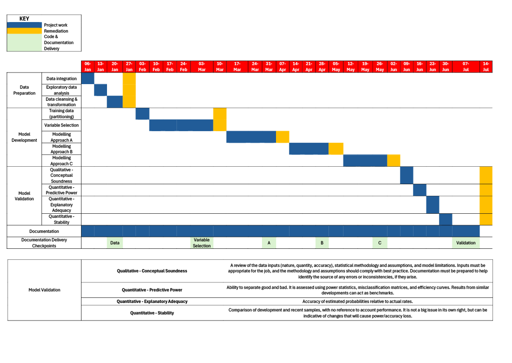
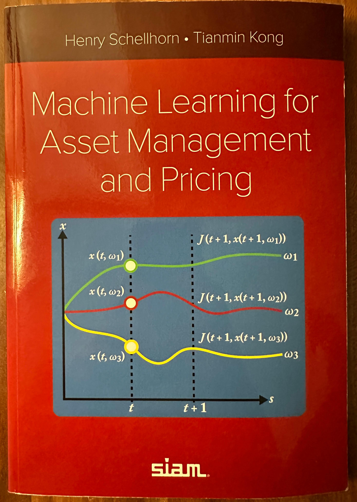

# Project Delivery, Stakeholder Dynamics & Examiner Review

The main repository contains the technical Python replication of the PPGD challenger framework. This folder covers the other side of the work: how the real project was planned and delivered, how I worked with the people who relied on it, and what the assessors said.

### Contents
- [**`Assessor Feedback`**](AP%20Qualitative%20Review.pdf) — report across the three assessment methods (AM1, AM2, AM3).
- [**`Grading criteria.pdf`**](Grading%20criteria.pdf) — The assessment rubric.

---

## 1. Project Delivery

Regulatory model development depends on sequential sign-offs, and once a model is in validation its inputs cannot keep changing. I therefore planned the project as a gated (Waterfall) schedule rather than an iterative one:

1. Approve the final list of risk drivers.
2. Freeze the data partitions.
3. Build the challenger models.
4. Run four validation phases on that fixed baseline: conceptual soundness, predictive power, explanatory adequacy and stability.
5. Finalise the documentation and support colleagues with Python training.

This gave senior stakeholders early visibility of bottlenecks and helped keep the scope fixed during the move from SAS to Python. The project, its documentation and the training were delivered on schedule.

---

## 2. Working with stakeholders

The main challenges were cultural and operational as much as mathematical. Each group needed something different from the work.

**Senior leadership**
- *What they needed:* clarity on strategic value (capital impact) and whether a move away from legacy SAS was realistic. They had limited time and little interest in code walk-throughs.

**Independent model validators**
- *What they needed:* to trace every figure back to its data source, and to be able to challenge the model before regulatory review.

**Finance analysts who run the models**
- *What they needed:* operational stability. A new script could not disrupt quarterly reporting.

**Data engineers and fellow data scientists**
- *What they needed:* clear requirements for sourcing mortgage, possession and recoveries data.

---

## 3. Assessor feedback and my reflection

Going through the End-Point Assessment (a 5,000-word report, presentation, 90-minute professional discussion, and a closed-book technical exam) was an intense process, so achieving a Distinction across every component was a massive milestone. Looking at the assessor's feedback, a few points really stood out to me:

- **On Commercial Trade-offs & Stakeholder Adaptation (AM1):** The assessor noted that I *"demonstrated a clear articulation of commercial awareness of organisational priorities and the practical trade-offs in implementing AI or data science solutions"* and highlighted how I *"adapted my approach to meet the diverse needs"* of data scientists, model owners, and financial analysts. It is great to be recognised for this, because in quantitative finance a technically brilliant model is useless if you cannot convince model owners and validators to trust it. Framing the project around tangible business value—cost savings, capital accuracy, and upskilling the team was deliberate from day one.

- **On Banking AI Governance & Wider Impact (AM2):** In the professional discussion, the examiner highlighted my evaluation of AI applications across banking alongside *"an awareness of the associated risks within the banking context, such as potential biases or over-reliance on automated systems"*. Having worked under strict regulatory frameworks, I felt it was vital to show that deploying machine learning isn't about automating everything blindly. It requires keeping human domain judgement in the loop and guarding against unintended bias in collections and lending decisions.

- **On Architectural Justification & Uncertainty (AM3):** For the technical test, the assessor commended how I *"compared machine learning models like decision tree and XGBoost, discussing their strengths, weaknesses, and applicability"* and clearly distinguished between *"irreducible uncertainty and reducible uncertainty"* in data collection and analysis. Being recognised for this statistical rigour was particularly rewarding; when modelling long-horizon outcomes like mortgage possession or consumer behaviour, knowing what variance you can engineer away via better features (reducible) versus what is inherent macroeconomic noise (irreducible) is what stops you from overfitting.

---

## 4. Beyond the Apprenticeship: Current Focus & Reading

This section will be updated as I continue to explore the intersection of machine learning, optimisation, and commercial decision-making. My current focus is on Dynamic Pricing & Mathematical Optimisation, which builds on the statistical foundations I developed during the apprenticeship.

<table>
  <tr>
    <td valign="top" width="65%">
      
<strong> Dynamic Pricing & Mathematical Optimisation</strong>

      

        Since completing this apprenticeship, I have shifted my focus from credit risk into large-scale commercial revenue optimisation and dynamic pricing</strong>.
      

      
The mathematical architecture I am building combines four core components:

      <ul>
        <li>Multi-Horizon Demand Forecasting
        <li>Price Elasticity Modelling
        <li>Mathematical Optimisation
      </ul>
      
<strong>Current Reading</strong>

      

        To deepen the theoretical foundations behind this work, I am currently reading <strong><em>Machine Learning for Asset Management and Pricing</em></strong> by Henry Schellhorn and Tianmin Kong (SIAM). The text bridges stochastic control, multi-period state transitions, and machine learning for pricing dynamics, providing strong mathematical parallels for how we model state-dependent demand and optimise pricing decisions over time.
      

    </td>
    <td valign="top" width="50%" align="center">
      
    </td>
  </tr>
</table>