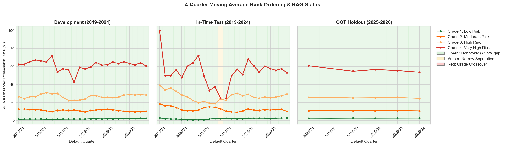
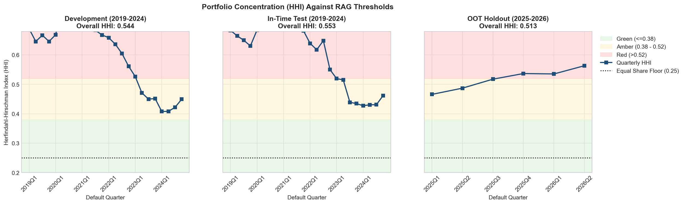
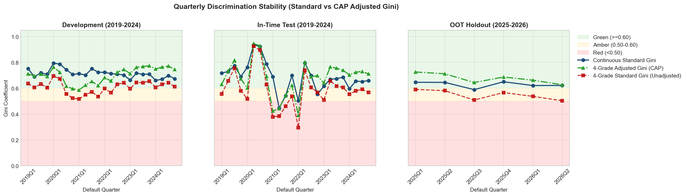
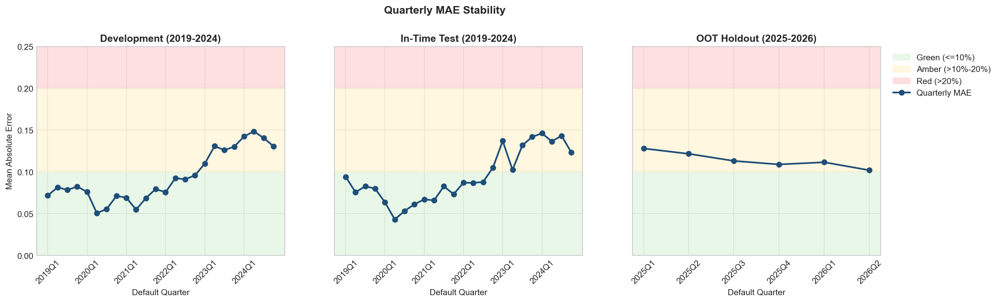
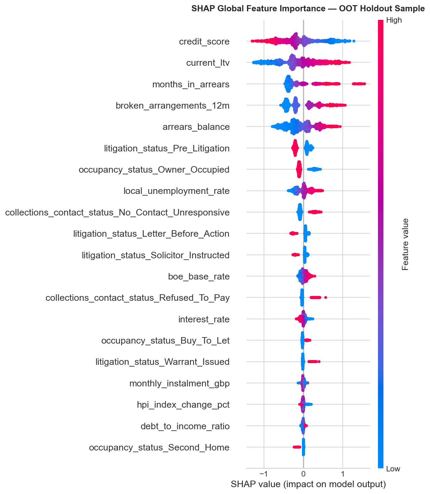
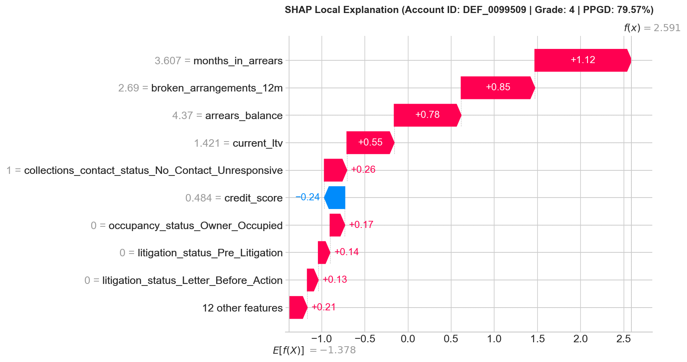

## Challenger Model for Mortgage Possession Risk (Probability of Possession Given Default)

This repository summarises my Level 7 Artificial Intelligence apprenticeship, delivered by Cambridge Spark while I worked in the quantitative modelling team. It describes the assessments, the project they were based on, and the professional evidence behind them.

> **Confidentiality note**
> This repository does not contain proprietary employer data, internal code, documents, or live model results. To demonstrate the end-to-end engineering and validation framework publicly, it includes a bespoke Monte Carlo data generator calibrated to public UK macroeconomic series and aligned with published regulatory standards, including Basel III/IV and PRA SS1/23.

---

## Assessment summary

| Assessment | Format | Outcome |
|---|---|---|
| **Project report and presentation** | Approximately 5,000-word technical report, 30-minute presentation, 45-minute technical Q&A | **Distinction** |
| **Professional discussion** | 90-minute structured discussion supported by a portfolio of evidence | **Distinction** |
| **Technical knowledge test** | 100-minute closed-book exam, four long-response scenario questions | **Distinction** |

---

## 1. Commercial project background

### Regulatory context

Banks that model retail mortgage losses under the Internal Ratings-Based (IRB) and IFRS 9 frameworks estimate Loss Given Default (LGD). A primary component of mortgage LGD is the **Probability of Possession Given Default (PPGD)**: once a loan enters default, how likely is it that the property will ultimately be repossessed? PPGD feeds directly into LGD, which combines with Probability of Default (PD) and Exposure at Default (EAD) to determine regulatory capital requirements and impairment provisions. Under UK **PRA SS1/23** Model Risk Management principles, firms are expected to develop and benchmark challenger models alongside incumbent production models.

### Scope and objectives

A decision tree that creates account risk grades using a limited feature set can lead to oversimplified risk assessments. I developed a machine-learning challenger framework covering accounts in default and pre-default cohorts. The objective was to capture non-linear risk interactions across a broader feature space, improve calibration accuracy, and establish a method for migrating model development from SAS to Python.

### Trade-offs and real-world governance considerations

- **Explainability:** A gradient-boosted ensemble requires mathematical justification and post-hoc explainability using SHAP to satisfy internal validation and regulatory scrutiny.
- **Productionisation and compute:** Transitioning large-scale data pipelines from legacy SAS servers to local or cloud Python environments requires careful memory management and modular preprocessing.
- **External data governance:** Macroeconomic and house-price-index inputs sit outside internal system controls and require stability and boundary checks before ingestion.

### Professional discussion: broader impact

- **Knowledge transfer:** Established Python adoption infrastructure, including technical channels, shared repositories, and training materials, to support a 60-person quantitative analytics function.
- **Quality assurance:** Peer-reviewed codebase updates for internal analysts and external consultants, and validated SAS-to-Python logic translations.
- **Stakeholder management:** Translated statistical outputs into actionable governance packs for Finance, Internal Audit, and Legal teams.
- **Model monitoring:** Designed a quarterly Red-Amber-Green (RAG) performance monitoring framework for senior risk committees.

---

## 2. Open-source Python replication architecture

The public replication provides a self-contained pipeline covering synthetic portfolio generation, regulatory feature selection, model tuning, K-Means Master Rating Scale grading, and multi-period validation.

```text
Mortgage-Risk-Modelling/
├── assets/
│   └── charts/                                    # Exported RAG validation and SHAP visuals
├── data/
│   ├── model_artefacts/                           # Serialised models, metadata and scored CSVs
│   ├── raw_macro/                                 # Public UK macroeconomic series
│   ├── synthetic_portfolio/                       # Generated train, test and OOT cohorts
│   └── README.md                                  # Public macro-data sourcing instructions
├── notebooks/
│   ├── 01_macro_data_exploration.ipynb            # Macro regime analysis and portfolio generation
│   ├── 02_feature_selection_and_ranking.ipynb     # Sequential regulatory feature filter
│   ├── 03_model_build.ipynb                       # Leak-free model build and K-Means grading
│   └── 04_model_evaluation.ipynb                  # RAG validation and SHAP explainability
├── Project-Planning/
│   └── ML Project Plan.pdf                        # Architecture and project scoping
├── src/
│   ├── 01_synthetic_data_generator.py             # Monte Carlo portfolio generator
│   ├── 02_data_preparation.py                     # Data preparation utilities
│   ├── 03_xgboost_ppgd_model.py                   # PPGD modelling utilities
│   ├── 04_kmeans_risk_grading.py                  # Risk-grade assignment utilities
│   └── 05_regulatory_validation.py                # Validation utilities
└── README.md
```

### End-to-end pipeline walkthrough

1. **Macroeconomic and portfolio generation (`01_macro_data_exploration.ipynb`)**

   The pipeline combines public UK macroeconomic series with a Monte Carlo simulation in [`src/01_synthetic_data_generator.py`](src/01_synthetic_data_generator.py) to generate a master book of 100,000 accounts. The modelling population contains 84,737 defaulted residential mortgage exposures across the candidate variables, with an approximately 7% possession rate.

   To prevent data leakage and test temporal resilience, the population is split into:

   - **Development set (80% in-time, 2019–2024):** 48,838 accounts; observed PPGD 6.80%.
   - **In-time test set (20% holdout, 2019–2024):** 12,210 accounts; observed PPGD 6.81%.
   - **Out-of-time (OOT) holdout (2025–2026):** 23,689 accounts; observed PPGD 7.36%.

2. **Sequential regulatory feature selection (`02_feature_selection_and_ranking.ipynb`)**

   A transparent six-stage funnel is used instead of a black-box recursive wrapper:

   - **Stage 1:** Validity checks.
   - **Stage 2:** Completeness, with a 5% missingness threshold.
   - **Stage 3:** Categorical concentration, with a 95% single-level cap.
   - **Stage 4:** Winsorisation at the 1st and 99th percentiles.
   - **Stage 5:** Univariate Weight of Evidence (WoE) and group-weighted AUC ranking.
   - **Stage 6:** Spearman rank intercorrelation filtering at (|rho| > 0.70).

   This reduces the candidate variables to 14 orthogonal credit-risk drivers.

3. **Model build and Master Rating Scale segmentation (`03_model_build.ipynb`)**

   - Fits a `ColumnTransformer` using median imputation, learned quantile winsorisation, standard scaling, and one-hot encoding strictly on the Development set.
   - Tunes Logistic Regression, Random Forest, LightGBM, and Champion XGBoost using stratified cross-validation.
   - Applies training-only class reweighting to improve minority-event learning while preserving the observed population prevalence during scoring.
   - Applies analytical prior correction before evaluation and grading.
   - Fits one-dimensional K-Means clustering (k=4) to calibrated Development PPGDs.
   - Maps the continuous scores into four named risk grades:
     - Grade 1: **Low Risk**
     - Grade 2: **Moderate Risk**
     - Grade 3: **High Risk**
     - Grade 4: **Very High Risk**

4. **Regulatory validation and explainability (`04_model_evaluation.ipynb`)**

   The Champion XGBoost model and K-Means rating system are evaluated across Development, In-Time Test, and OOT cohorts. The notebook includes rank ordering, concentration, heterogeneity, discrimination, accuracy, classification diagnostics, matched-sample Welch tests, and global/local SHAP explainability.

---

## 3. Key methodological highlights

### A. Minority-class reweighting and analytical Bayes prior restoration

Possession is a minority event in the defaulted mortgage population, with a 6.80% Development base rate. Training tree ensembles on raw imbalanced priors can under-allocate splits to high-risk tail interactions.

During training, instance weights target an effective 20.00% minority event rate. Because reweighting changes the model's predicted log-odds, raw outputs are not used directly for capital or provisioning calculations. Before risk grading or evaluation, predicted probabilities are analytically recalibrated to the observed Development prior:

$$
\text{Odds}_{\text{pop}} =
\frac{\hat{p}_{\text{weighted}}}{1-\hat{p}_{\text{weighted}}}
\times
\frac{\pi_{\text{pop}}/(1-\pi_{\text{pop}})}
{\pi_{\text{train}}/(1-\pi_{\text{train}})}
$$

$$
\text{PPGD}_{\text{calibrated}} =
\frac{\text{Odds}_{\text{pop}}}{1+\text{Odds}_{\text{pop}}}
$$

This preserves minority-feature learning while maintaining portfolio-level calibration.

### B. CAP-adjusted Gini for tied grade distributions

The standard Gini coefficient is:

$$
\text{Standard Gini} = 2 \times (\text{AUC} - 0.5)
$$

Mapping continuous probabilities into four grades creates tied scores. The evaluation therefore reports a CAP-adjusted Gini using the maximum CAP area achievable while preserving the observed grade bucket sizes. Within each grade, the benchmark places defaults before cures; it does not reorder grades by their realised default rates.

$$
\text{Adjusted Gini} =
\frac{\text{Model CAP Area}}
{\text{Maximum Achievable CAP Area}}
$$

This separates the discriminatory power achieved by the discrete scale from the loss caused solely by ties within grades.

---

## 4. Regulatory validation and RAG thresholds

The exported charts are available in [`assets/charts/`](assets/charts/), and the underlying calculations are in [`notebooks/04_model_evaluation.ipynb`](notebooks/04_model_evaluation.ipynb).

### Rank Ordering

Grades should remain distinct and strictly monotonic over time:

**Grade 1 < Grade 2 < Grade 3 < Grade 4**

A four-quarter moving average reduces seasonal noise. The notebook checks quarterly crossovers and compressed adjacent-grade differences, with the result displayed using the rank-ordering RAG chart.



Rank ordering remains stable across the Development and Out-of-Time (OOT) cohorts, with a single amber alert occurring in Q4 2021 within the smaller In-Time Test split. This sudden drop in Grade 4 possession rates was driven by COVID-19 policy interventions: FCA repossession moratoriums and payment holidays halted enforcement until mid-2021, and subsequent court backlogs delayed possession warrants for the riskiest accounts. This compression reflects a temporary legal backlog rather than model failure and normalises once court capacity clears in 2022. No threshold changes are required, and the period is simply logged as a policy distortion under PRA SS1/23.

---

### Concentration and Heterogeneity

The Herfindahl-Hirschman Index (HHI) is:

$$
\text{HHI} = \sum_i s_i^2
$$

where \(s_i\) is the share of accounts in grade \(i\). With four grades, an equal split has a theoretical minimum HHI of 0.25. The current evaluation RAG bands are:

- **Green:** HHI ≤ 0.38
- **Amber:** 0.38 < HHI ≤ 0.52
- **Red:** HHI > 0.52

K-Means identifies natural score boundaries rather than forcing equal grade volumes. Consequently, right-skewed mortgage portfolios can concentrate curing accounts in Grade 1. The Welch tests use equal-sized matched samples of up to 200 accounts per grade pair and report grade names, mean PPGD differences, effect sizes, and a significance flag.



The HHI chart shows concentration sitting in the **Red (>0.52)** zone through 2021 before falling sharply into the **Amber** band from 2023 to 2025, and drifting back above 0.52 in late OOT. During the ultra-low interest rate environment and Stamp Duty holiday of 2020–2021, rising house prices gave defaulted borrowers the equity to self-cure or sell voluntarily, clustering most of the book into Grade 1. When the Bank of England raised base rates from late 2022 to combat inflation, payment shocks pushed more borrowers into deeper arrears, spreading volume across Grades 2–4 and lowering HHI. As rates began easing in 2025–2026, higher cure rates returned accounts to Grade 1. Rather than forcing artificial equal-sized buckets, this concentration is defended at committee using the Welch *t*-tests to prove the grades remain statistically distinct, alongside a proposal to split Grade 1 into two sub-grades (`1A/1B`) if finer capital reporting is needed.

---

### Discrimination, Stability and Accuracy

The notebook tracks quarterly continuous Gini, four-grade standard Gini, and four-grade CAP-adjusted Gini across all cohorts. The discrimination RAG bands are:

- **Green:** Gini ≥ 0.60
- **Amber:** 0.50 ≤ Gini < 0.60
- **Red:** Gini < 0.50



Two key anomalies stand out in the discrimination chart: a sharp **Red (<0.50)** drop in the In-Time Test set during 2021, and a persistent gap between the **Amber** unadjusted 4-grade Gini and the **Green** CAP-adjusted Gini in OOT. The 2021 drop occurred because the COVID-19 repossession ban prevented high-risk borrowers in deep arrears from actually being repossessed, creating temporary false positives until enforcement resumed in 2022. In the 2025–2026 OOT cohort, the unadjusted 4-grade Gini sits in Amber solely because heavy curing in Grade 1 creates tied scores that mathematically penalise standard AUC; once adjusted for bucket sizes via the CAP benchmark, discrimination remains solidly **Green (>0.62)**. Consequently, ongoing monitoring is anchored to the CAP-adjusted and continuous Gini series to avoid false-positive escalations.

Quarterly MAE is also charted for Development, In-Time Test, and OOT:

- **Green:** MAE ≤ 10%
- **Amber:** 10% < MAE ≤ 20%
- **Red:** MAE > 20%



The overall table additionally reports KS statistic, RMSE, and Brier score. The time-series charts are intended to show whether performance remains stable rather than relying only on a single point estimate.

While MAE sits comfortably in the **Green (≤10%)** band up to mid-2022, it jumps into the **Amber (>10%–20%)** zone from late 2022 onwards and remains slightly elevated (~10–13%) in the OOT cohort. This upward shift coincided with the rapid Bank of England base rate hikes and cost-of-living squeeze, which made it harder for defaulted borrowers to clear arrears and raised the observed OOT possession rate to 7.36% (up from the 6.80% Development baseline). The model's Bayes prior calibration is locked to the 6.80% Development rate to avoid data leakage, that macro shift shows up as a steady calibration gap. Since the Green Gini proves the model still rank-orders risk well, a full model rebuild is unnecessary; instead, the governance action is to apply a temporary Post-Model Adjustment (PMA) uplift to Grade 3 and 4 LGD provisions.

---

### Model explainability

To support PRA SS1/23 transparency expectations, `shap.TreeExplainer` is used to audit:

- global portfolio drivers using the OOT population;
- local account-level risk attributions for high-risk Grade 4 exposures.

<p align="center">
  
  
</p>

<p style="font-size: inherit;">A common regulatory concern with machine learning models is that volatile macroeconomic indicators (boe_base_rate, local_unemployment_rate) might overpower borrower-specific behaviour during economic shocks. The global SHAP plot confirms this does not happen: core account distress and equity metrics (credit_score, current_ltv, months_in_arrears, and broken_arrangements_12m) drive the bulk of the predictions, with high LTV acting as the main economic transmission channel when stagnating house prices prevent voluntary sales. On the right, the local waterfall plot for a Grade 4 exposure (DEF_0099509, PPGD 79.57%) shows clear account-level logic, where severe arrears and broken payment arrangements drive the high risk score, giving collections teams transparent reasons before initiating litigation.</p>

---

## 5. How to reproduce

1. **Clone the repository**

   ```bash
   git clone https://github.com/Beck40/Mortgage-Risk-Modelling.git
   cd Mortgage-Risk-Modelling
   ```

2. **Install the Python dependencies**

   ```bash
   pip install -r requirement.txt
   ```

3. **Acquire the public macroeconomic datasets**

   Follow [`data/README.md`](data/README.md) to source the required public datasets into `data/raw_macro/`.

4. **Generate the synthetic portfolio**

   ```bash
   python src/01_synthetic_data_generator.py
   ```

5. **Run the notebooks in order**

   Execute notebooks 01 through 04. The generated model artefacts and scored cohorts are written under `data/model_artefacts/`; generated portfolio CSVs are written under `data/synthetic_portfolio/`.

---

## References

<table>
  <tr>
    <td valign="top" width="70%">
      <p><strong>Core Literature:</strong></p>
      <p>
        The quantitative validation framework, backtesting protocols, and model governance standards implemented in this repository are informed by:
      </p>
      <p>
        <strong><em>The Validation of Risk Models: A Handbook for Practitioners</em></strong> by Sergio Scandizzo.
      </p>
      <p>Key methodologies drawn from this text and integrated into the pipeline include:</p>
      <ul>
        <li><strong>Concentration & Heterogeneity:</strong> Applying the Herfindahl-Hirschman Index (HHI) to quantify rating band concentration and ensure the K-Means risk segments avoid degenerate clustering.</li>
        <li><strong>Population & Characteristic Drift:</strong> Using Population Stability Index (PSI) and migration matrices to evaluate distribution shifts between Development, In-Time Test, and Out-of-Time (OOT) cohorts.</li>
        <li><strong>Discrimination & Calibration Stability:</strong> Benchmarking discriminatory power via standard and CAP-adjusted Gini coefficients, paired with Welch-t diagnostics to confirm statistical separation across risk grades.</li>
      </ul>
      <p><strong>Regulatory Standards:</strong></p>
      <ul>
        <li><a href="https://www.bankofengland.co.uk/-/media/boe/files/prudential-regulation/supervisory-statement/2023/ss123.pdf">PRA SS1/23: Model risk management principles for banks</a></li>
        <li><a href="https://www.bis.org/bcbs/basel3.htm">Basel III/IV: International regulatory framework for banks</a></li>
        <li><a href="https://skillsengland.education.gov.uk/apprenticeship-standards/st0763-v1-0">Cambridge Spark Apprenticeship Standard ST0763 (Level 7 AI)</a></li>
      </ul>
    </td>
    <td valign="top" width="70%" align="center">
      
    </td>
  </tr>
</table>
