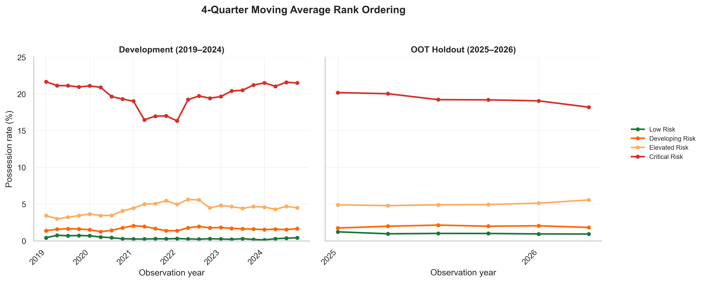
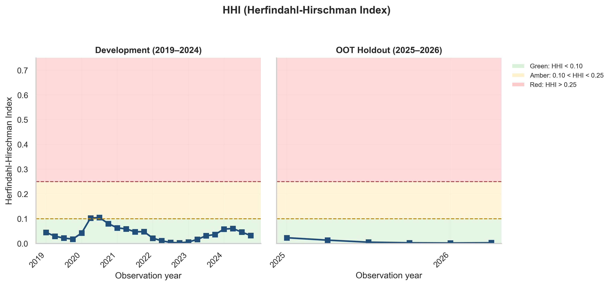
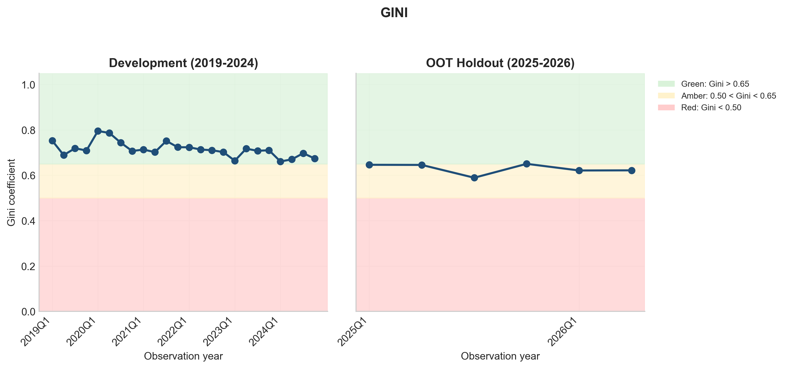
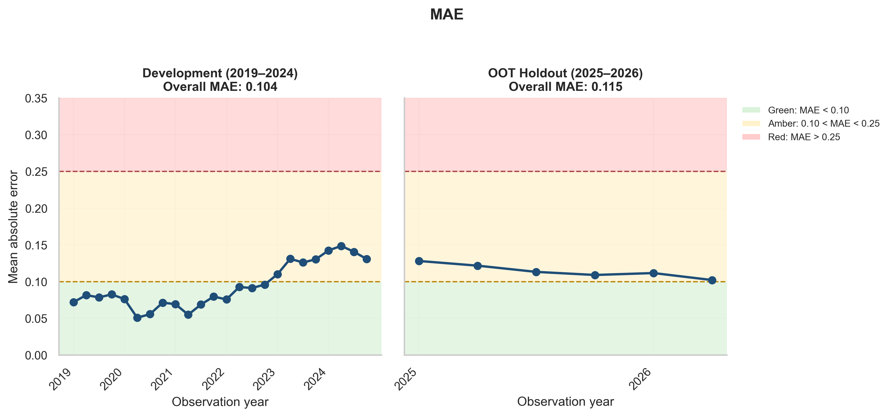
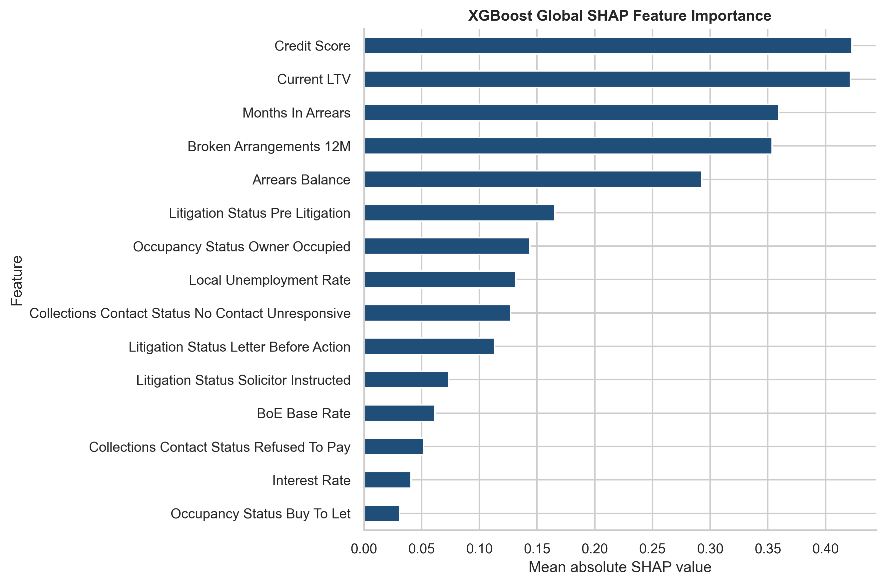
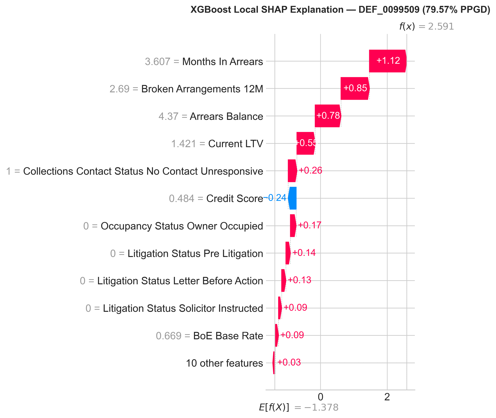

## Challenger Model for Mortgage Possession Risk (Probability of Possession Given Default)

This repository summarises my MSc Artificial Intelligence Apprenticeship (level 7 study). It describes the assessments, the project they were based on, and the professional evidence behind them.

> **Confidentiality note**
> This repository does not contain proprietary employer data, internal code, documents, or live model results. To demonstrate the end-to-end engineering and validation framework publicly, it includes a bespoke Monte Carlo data generator calibrated to public UK macroeconomic series and aligned with published regulatory standards, including Basel III/IV and PRA SS1/23.

---

## 1. Summary

| Assessment | Format | Outcome |
|---|---|---|
| **Project report and presentation** | Approximately 5,000-word technical report, 30-minute presentation, 45-minute technical Q&A | **Distinction** |
| **Professional discussion** | 90-minute structured discussion supported by a portfolio of evidence | **Distinction** |
| **Technical knowledge test** | 100-minute closed-book exam, four long-response scenario questions | **Distinction** |

---

## 2. Objective

This personal project demonstrates an end-to-end, PRA SS1/23-aligned challenger
model development and validation workflow for mortgage possession risk. It
combines synthetic UK mortgage data, supervised machine learning, explainability,
and production-style RAG monitoring to show how a primary model can be governed
through Development and Out-of-Time validation.

### Regulatory context

Banks that model retail mortgage losses under the Internal Ratings-Based (IRB) and IFRS 9 frameworks estimate Loss Given Default (LGD). A primary component of mortgage LGD is the **Probability of Possession Given Default (PPGD)**: once a loan enters default, how likely is it that the property will ultimately be repossessed? PPGD feeds directly into LGD, which combines with Probability of Default (PD) and Exposure at Default (EAD) to determine regulatory capital requirements and impairment provisions. Under UK **PRA SS1/23** Model Risk Management principles, firms are expected to develop and benchmark challenger models alongside incumbent production models.

### Scope and objectives

A decision tree that creates account risk grades using a limited feature set can lead to oversimplified risk assessments. I developed a machine-learning challenger framework covering accounts in default and pre-default cohorts. The objective was to capture non-linear risk interactions across a broader feature space, improve calibration accuracy, and establish a method for migrating model development from SAS to Python.

### Trade-offs and real-world governance considerations

- **Explainability:** A gradient-boosted ensemble requires mathematical justification and post-hoc explainability using SHAP to satisfy internal validation and regulatory scrutiny.
- **Productionisation and compute:** Transitioning large-scale data pipelines from legacy SAS servers to local or cloud Python environments requires careful memory management and modular preprocessing.
- **External data governance:** Macroeconomic and house-price-index inputs sit outside internal system controls and require stability and boundary checks before ingestion.

### Professional discussion: broader impact

- **Knowledge transfer:** Established Python adoption infrastructure, including technical channels, shared repositories, and training materials, to support a 60-person quantitative analytics function.
- **Quality assurance:** Peer-reviewed codebase updates for internal analysts and external consultants, and validated SAS-to-Python logic translations.
- **Stakeholder management:** Translated statistical outputs into actionable governance packs for Finance, Internal Audit, and Legal teams.
- **Model monitoring:** Designed a quarterly Red-Amber-Green (RAG) performance monitoring framework for senior risk committees.

---

## 3. Open-source Python replication

The public replication provides a self-contained pipeline covering synthetic portfolio generation, regulatory feature selection, model tuning, K-Means Master Rating Scale grading, and multi-period validation.

```text
Mortgage-Risk-Modelling/
├── assets/
│   └── charts/                                    # Exported RAG validation and SHAP visuals
├── data/
│   ├── model_artefacts/                           # Serialised models, metadata and scored CSVs
│   ├── raw_macro/                                 # Public UK macroeconomic series
│   ├── synthetic_portfolio/                       # Generated Development and OOT cohorts
│   └── README.md                                  # Public macro-data sourcing instructions
├── notebooks/
│   ├── 01_macro_data_exploration.ipynb            # Macro regime analysis and portfolio generation
│   ├── 02_feature_selection_and_ranking.ipynb     # Sequential regulatory feature filter
│   ├── 03_model_build.ipynb                       # Leak-free model build and K-Means grading
│   └── 04_model_evaluation.ipynb                  # RAG validation and SHAP explainability
├── Project-Planning/
│   └── ML Project Plan.pdf                        # Architecture and project scoping
├── src/
│   ├── __init__.py                                # Importable package initialisation
│   ├── data_generator.py                          # Monte Carlo portfolio generator
│   ├── data_preparation.py                        # Sequential feature selection
│   ├── ppgd_model.py                              # PPGD modelling pipeline
│   ├── risk_grading.py                            # K-Means and quartile risk grading
│   ├── regulatory_validation.py                   # Regulatory validation metrics
│   └── generate_charts.py                         # Validation and SHAP visualisations
├── tests/
│   └── test_pipeline.py                           # Fast offline unit tests
├── .github/
│   └── workflows/
│       └── ci.yml                                 # pytest CI on pushes and pull requests
└── README.md
```

### End-to-end pipeline walkthrough

1. **Portfolio generation (`01_macro_data_exploration.ipynb`)**

   The pipeline combines public UK macroeconomic series with a Monte Carlo simulation in [`src/data_generator.py`](src/data_generator.py) to generate a master book of 100,000 accounts. The modelling population contains 84,737 defaulted residential mortgage exposures across the candidate variables, with an approximately 7% possession rate.

   To prevent data leakage and test resilience, the population is split into:

   - Development (2019–2024): 48,838 scored accounts used for model development and calibration.
   - Out-of-Time validation (2025–2026): 23,689 fully held-out scored accounts.

   The OOT holdout is evaluated directly against Development because it tests
   true macroeconomic regime stability rather than adding a redundant in-time
   random split.

2. **Feature selection (`02_feature_selection_and_ranking.ipynb`)**

   A transparent six-stage funnel is used instead of a black-box recursive wrapper:

   - **Stage 1:** Validity checks.
   - **Stage 2:** Completeness, with a 5% missingness threshold.
   - **Stage 3:** Categorical concentration, with a 95% single-level cap.
   - **Stage 4:** Winsorisation at the 1st and 99th percentiles.
   - **Stage 5:** Univariate Weight of Evidence (WoE) and group-weighted AUC ranking.
   - **Stage 6:** Spearman rank intercorrelation filtering at (|rho| > 0.70).

   This reduces the candidate variables to 14 orthogonal credit-risk drivers.

3. **Model build (`03_model_build.ipynb`)**

   - Fits a `ColumnTransformer` using median imputation, learned quantile winsorisation, standard scaling, and one-hot encoding strictly on the Development set.
   - Benchmarks candidate models with stratified cross-validation and uses XGBoost as the primary model for validation and monitoring.
   - Applies training-only class reweighting to improve minority-event learning while preserving the observed population prevalence during scoring.
   - Applies analytical prior correction before evaluation and grading.
   - Fits one-dimensional K-Means clustering (k=4) to calibrated Development PPGDs and applies a Development-fitted balanced grade policy for monitoring.
   - Maps the continuous scores into four named risk grades:
     - Grade 1: **Low Risk**
     - Grade 2: **Developing Risk**
     - Grade 3: **Elevated Risk**
     - Grade 4: **Critical Risk**

4. **Regulatory validation and Explainability (`04_model_evaluation.ipynb`)**

   The primary XGBoost model and K-Means rating system are evaluated across
   Development and OOT cohorts. The notebook includes rank ordering,
   concentration, heterogeneity, discrimination, accuracy, calibration
   t-tests, classification diagnostics, and global/local SHAP explainability.

---

## 4. Key methodological highlights

### CAP-adjusted Gini for tied grade distributions

The standard Gini coefficient is:

$$
\text{Standard Gini} = 2 \times (\text{AUC} - 0.5)
$$

Mapping continuous probabilities into four grades creates tied scores. The evaluation therefore reports a CAP-adjusted Gini using the maximum CAP area achievable while preserving the observed grade bucket sizes. Within each grade, the benchmark places defaults before cures; it does not reorder grades by their realised default rates.

$$
\text{Adjusted Gini} =
\frac{\text{Model CAP Area}}
{\text{Maximum Achievable CAP Area}}
$$

This separates the discriminatory power achieved by the discrete scale from the loss caused solely by ties within grades.

---

## 5. Regulatory validation and RAG thresholds

The exported charts are available in [`assets/charts/`](assets/charts/), and the underlying calculations are in [`notebooks/04_model_evaluation.ipynb`](notebooks/04_model_evaluation.ipynb).

### Rank Ordering and Monotonicity

Risk grades must remain distinct and strictly monotonic over time so that higher risk grades consistently exhibit higher realised possession rates:

**Low Risk < Developing Risk < Elevated Risk < Critical Risk**

In the development cohort, the mean observed possession rates across the four grades are approximately 0.4%, 1.6%, 4.4%, and 20.8% respectively. Grade 4 isolates the acute tail of heavily distressed accounts where voluntary sale or cure is unlikely, whereas Grades 1 to 3 provide granular separation across lower-to-mid risk exposures. A four-quarter moving average is applied to smooth seasonal noise.




<br>

The model maintains strict monotonicity across both Development and OOT time horizons, with zero crossovers, keeping a minimum adjacent four-quarter gap of 0.73 percentage points in Development and 0.52 percentage points in OOT. In the Development panel, Grade 4 possession rates dip from ~21.5% in 2019–2020 to ~16.3% across 2021–2022, reflecting the FCA's COVID-19 repossession, payment deferral schemes, and County Court backlogs. Rates then return to ~20%–21.5% in 2023–2024 as court capacity resumed and post-Mini-Budget interest rate hikes increased borrower distress, before stabilising around 18%–20% in the 2025–2026 OOT holdout as base rates eased.

---

### Concentration and Heterogeneity

The Herfindahl-Hirschman Index (HHI) is:

$$
\text{HHI} = \sum_i s_i^2
$$
where $s_i$ is the share of accounts in grade $i$. 

- **Green:** HHI < 0.10
- **Amber:** 0.10 < HHI < 0.25
- **Red:** HHI > 0.25

Since we have four grades, the raw HHI has a mathematical floor of 0.25, therefore the chart evaluates at quarterly normalised concentration

$$
HHI^*_t = \frac{\sum_{i=1}^{4} s_{i,t}^2 - 0.25}{0.75}
$$



<br>

Defaulted mortgage portfolios are right-skewed, so unconstrained K-Means clustering placed most curing accounts into Grade 1. Applying a Development-fitted balanced threshold policy resolves this skew, achieving a mean quarterly raw HHI of 0.281 ($\text{HHI}^* = 0.041$) in Development and 0.256 ($\text{HHI}^* = 0.008$) in OOT. 

Concentration briefly rises in 2020–2021 (raw HHI peaking near 0.33). Pandemic furlough support, a low 0.10% base rates, and Stamp Duty house-price gains all compressed borrowers into lower risk grades. Bank of England rate hikes took hold from 2022 onwards, risk profiles dispersed back toward the 0.25–0.28 mark and remained steady through the 2025–2026 OOT period.

| Period | Mean quarterly raw HHI | Mean quarterly HHI* | RAG status |
|---|---:|---:|---|
| Development (2019–2024) | 0.281 | 0.041 | Green |
| Out-of-Time (2025–2026) | 0.256 | 0.008 | Green |

### Heterogeneity

An independent two-sample Welch t-test compares score distributions across each pair of risk grades using equal-sized matched samples of up to 200 accounts. The RAG rule is Green when $p \le 0.05$ and Red otherwise.

| Grade pair | Mean score A | Mean score B | t-statistic | p-value | RAG status |
|---|---:|---:|---:|---:|---|
| Grade 1 Low Risk vs Grade 2 Developing Risk | 0.0090 | 0.0223 | -31.56 | <0.001 | <span style="color:green"><strong>Green</strong></span> |
| Grade 1 Low Risk vs Grade 3 Elevated Risk | 0.0090 | 0.0503 | -47.99 | <0.001 | <span style="color:green"><strong>Green</strong></span> |
| Grade 1 Low Risk vs Grade 4 Critical Risk | 0.0090 | 0.1749 | -20.38 | <0.001 | <span style="color:green"><strong>Green</strong></span> |
| Grade 2 Developing Risk vs Grade 3 Elevated Risk | 0.0223 | 0.0503 | -31.53 | <0.001 | <span style="color:green"><strong>Green</strong></span> |
| Grade 2 Developing Risk vs Grade 4 Critical Risk | 0.0223 | 0.1749 | -18.74 | <0.001 | <span style="color:green"><strong>Green</strong></span> |
| Grade 3 Elevated Risk vs Grade 4 Critical Risk | 0.0503 | 0.1749 | -15.23 | <0.001 | <span style="color:green"><strong>Green</strong></span> |

---

### Discrimination, Stability and Accuracy

The notebook tracks quarterly Gini through Development and OOT against the following RAG bands.

- **Green:** Gini > 0.65
- **Amber:** 0.50 < Gini < 0.65
- **Red:** Gini < 0.50



<br>

XGBoost records an overall Development Gini of 0.719 and an OOT Gini of 0.631. Discrimination peaks near 0.80 in 2020 when only severe legacy defaults progressed during initial pandemic restrictions, making them easy to separate from newer defaults. From 2023 into the 2025–2026 OOT period, Gini moderates to ~0.62–0.65 as prime borrowers rolling off cheap fixed-rate deals onto 5%+ rates experienced sudden payment shocks, slightly blurring the boundary between behavioural credit risk and affordability stress.

| Period | XGBoost Gini | Relative drop | RAG status |
|---|---:|---:|---|
| Development (2019–2024) | 0.719 | — | Green |
| Out-of-Time (2025–2026) | 0.631 | 12.2% | Amber |

Quarterly Mean Absolute Error (MAE) is monitored across the same timeline:

- **Green:** MAE < 0.10
- **Amber:** 0.10 < MAE < 0.25
- **Red:** MAE > 0.25



<br>

Overall MAE is 0.104 in Development and 0.115 in OOT. Quarterly error remains inside the Green band between 2019 and 2022 under low interest rates, before rising to ~0.13–0.15 in 2023–2024. This divergence reflects the 2022–2023 rate-hiking cycle alongside the July 2023 UK Mortgage Charter: deteriorating macro indicators pushed model risk scores higher, while mandatory lender forbearance (such as temporary interest-only switches and 12-month repossession grace periods) delayed physical possessions. In OOT (2025–2026), MAE steadily recovers from 0.129 back down to 0.101 as inflation and rates stabilised.

| Period | XGBoost MAE | RAG status |
|---|---:|---|
| Development (2019–2024) | 0.104 | Amber |
| Out-of-Time (2025–2026) | 0.115 | Amber |

---

### Model explainability

To support PRA SS1/23 transparency expectations, `shap.TreeExplainer` is used to audit global portfolio drivers and local account-level attributions on the OOT population.

<table align="center">
  <tr>
    <td align="center" width="50%">
      
    </td>
    <td align="center" width="50%">
      
    </td>
  </tr>
</table>

<p style="font-size: inherit;">A common regulatory concern with machine learning models is that volatile macroeconomic indicators (BoE base rate, local unemployment rate) might overpower borrower-specific behaviour during economic shocks. The global SHAP plot confirms this does not happen: core account distress and equity metrics (credit score, current LTV, months in arrears, and broken arrangements over 12 months) drive the bulk of the predictions, with high LTV acting as the main economic transmission channel when stagnating house prices prevent voluntary sales. On the right, the local waterfall plot shows an individual exposure where account-level arrears, broken payment arrangements, and LTV contributions are broken down transparently for collections teams before initiating litigation</p>

<br>

---

## 6. Quickstart

1. **Clone the repository**

   ```bash
   git clone https://github.com/Beck40/Mortgage-Risk-Modelling.git
   cd Mortgage-Risk-Modelling
   ```

2. **Install the Python dependencies**

   ```bash
   pip install -r requirements.txt
   ```

3. **Acquire the public macroeconomic datasets**

   Follow [`data/README.md`](data/README.md) to source the required public datasets into `data/raw_macro/`.

4. **Generate the synthetic portfolio**

   ```bash
   python -m src.data_generator
   ```

5. **Run the importable pipeline modules**

   ```bash
   python -m src.data_preparation
   python -m src.ppgd_model
   python -m src.risk_grading
   python -m src.regulatory_validation
   ```

   The generated model artefacts and scored cohorts are written under `data/model_artefacts/`; generated portfolio CSVs are written under `data/synthetic_portfolio/`.

6. **Generate the validation charts**

   ```bash
   python -m src.generate_charts
   ```

   Existing results and exported charts are preserved; this command regenerates charts only when intentionally run.

7. **Run the deterministic unit tests**

   ```bash
   python -m pytest
   ```

---

## 7. References

<table>
  <tr>
    <td valign="top" width="70%">
      <p><strong>Core Literature:</strong></p>
      <p>
        The quantitative validation framework, backtesting protocols, and model governance standards implemented in this repository are informed by:
      </p>
      <p>
        <strong><em>The Validation of Risk Models: A Handbook for Practitioners</em></strong> by Sergio Scandizzo.
      </p>
      <p>Key methodologies drawn from this text and integrated into the pipeline include:</p>
      <ul>
        <li><strong>Concentration & Heterogeneity:</strong> Applying the Herfindahl-Hirschman Index (HHI) to quantify rating band concentration and ensure the K-Means risk segments avoid degenerate clustering.</li>
        <li><strong>Population & Characteristic Drift:</strong> Using Population Stability Index (PSI) and migration matrices to evaluate distribution shifts between Development and Out-of-Time (OOT) cohorts.</li>
        <li><strong>Discrimination & Calibration Stability:</strong> Benchmarking discriminatory power via standard and CAP-adjusted Gini coefficients, paired with Welch-t diagnostics to confirm statistical separation across risk grades.</li>
      </ul>
      <p><strong>Regulatory Standards:</strong></p>
      <ul>
        <li><a href="https://www.bankofengland.co.uk/-/media/boe/files/prudential-regulation/supervisory-statement/2023/ss123.pdf">PRA SS1/23: Model risk management principles for banks</a></li>
        <li><a href="https://www.bis.org/bcbs/basel3.htm">Basel III/IV: International regulatory framework for banks</a></li>
        <li><a href="https://skillsengland.education.gov.uk/apprenticeship-standards/st0763-v1-0">Cambridge Spark Apprenticeship Standard ST0763 (Level 7 AI)</a></li>
      </ul>
    </td>
    <td valign="top" width="70%" align="center">
      
    </td>
  </tr>
</table>
